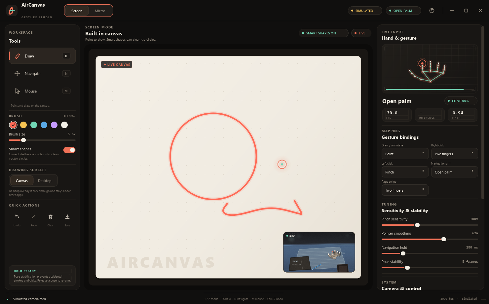
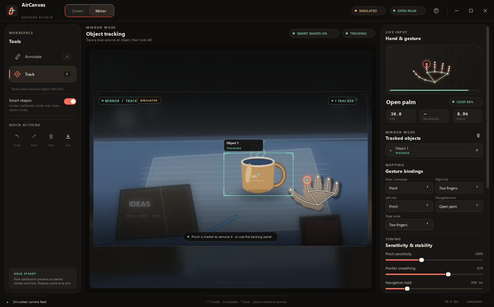
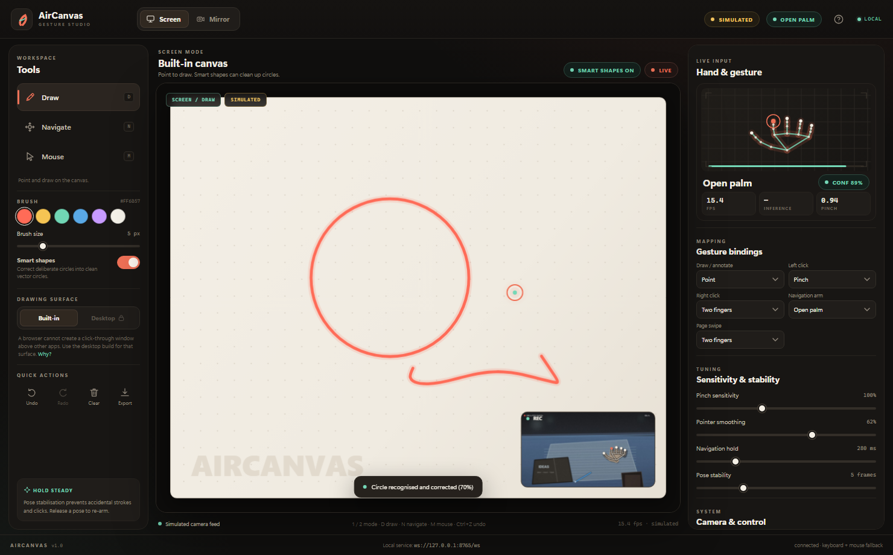
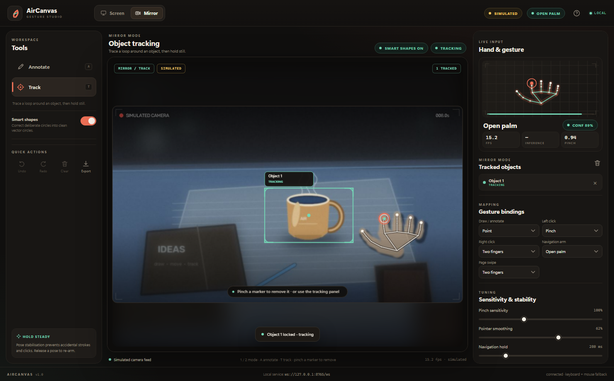
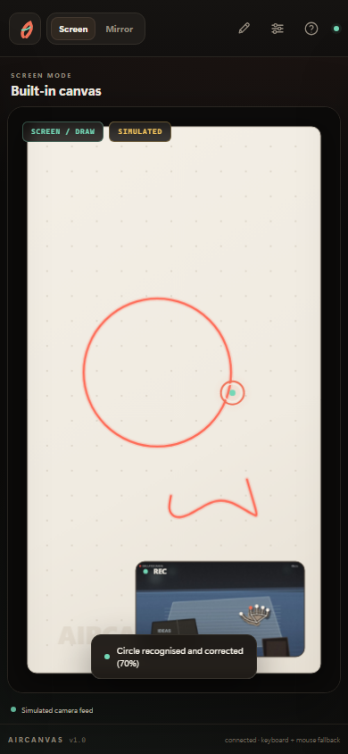
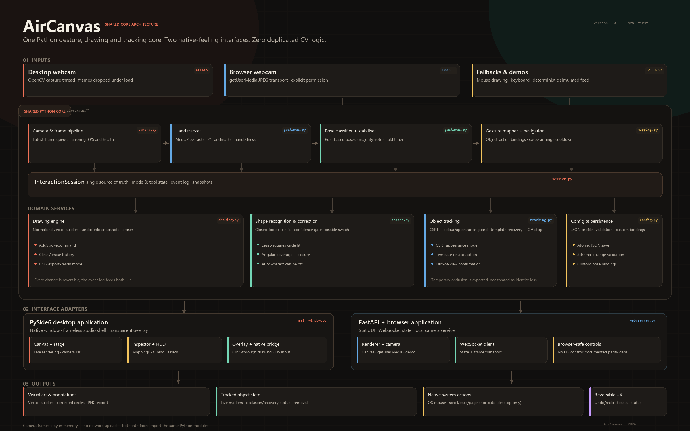

# AirCanvas

> **Touch the air. Draw the world.**
> A gesture-controlled interactive system with webcam hand tracking, a shared Python core, a PySide6 desktop application and a FastAPI browser application.

**Language:** English · [繁體中文](README_CN.md) · Chinese versions of the individual docs are the matching `*_CN.md` files in [`docs/`](docs/).

AirCanvas is a complete, local-first gesture interaction studio. It turns a webcam into a direct-manipulation surface for drawing, deliberate screen navigation, mouse control, mirror-mode annotation and circle-to-select object tracking. Both interfaces run the same Python modules — gesture recognition, mapping, drawing, shape correction, undo/redo and tracking are never reimplemented in JavaScript.



| Desktop · Mirror Mode | Browser · Screen Mode |
| --- | --- |
|  |  |
| **Browser · Mirror Mode** | **Responsive browser layout** |
|  |  |

---

## 1. What is included

| Requirement | Implementation |
| --- | --- |
| Screen drawing | Built-in vector canvas **and** click-through transparent desktop overlay (desktop build), switchable at runtime |
| Automatic circles | Conservative loop detection, least-squares circle fitting, optional correction toggle, undo-safe replacement |
| Screen navigation | Open-palm swipe up/down/left/right + two-finger swipe previous/next page; pose stability, arm hold, cooldown and single-fire per swipe |
| Mouse control | One Euro–smoothed air pointer, pinch drag, two-finger right-click, click ripples and native OS control behind explicit consent |
| Mirror annotation | Live camera feed with annotations kept in the video coordinate system; separate mirror drawing surface |
| Object selection/tracking | Fingertip loop detector, hold-to-lock, CSRT tracker with appearance guard, template recovery after occlusion, confirmed out-of-view termination, pinch/UI removal |
| Desktop UI | PySide6 native studio shell, frameless window, toolbar, inspector, onboarding, keyboard shortcuts, transparent overlay |
| Web UI | FastAPI + WebSocket + HTML/CSS/JavaScript, browser camera capture, responsive canvas renderer, in-browser controls |
| Hand model choice | Bundled MediaPipe; optional RTMPose-Hand (`rtmlib`) and custom 21-keypoint YOLO Pose (`.pt`) with readiness/error reporting |
| Shared core | `camera`, `gestures`, `hand_models`, `mapping`, `drawing`, `shapes`, `tracking`, `session`, `config`, `native`, `demo` |
| HCI | Object-Action mapping, direct manipulation, undo/redo, error prevention, universal usability, Gestalt grouping, onboarding and keyboard/mouse alternatives |
| Academic report | [Architecture](docs/ARCHITECTURE.md) · [Gesture map](docs/GESTURE_MAP.md) · [Interface comparison](docs/INTERFACE_COMPARISON.md) · [Browser limits](docs/BROWSER_LIMITATIONS.md) · [Testing](docs/TESTING.md) |
| Screenshots | `docs/screenshots/` (1480×920 desktop/web plus a 390×844 responsive view) |
| Architecture diagram | `docs/architecture_diagram.png` |

A labelled simulated camera feed is built in. It drives the **real** session, gesture stabiliser, drawing engine, loop selection and CSRT tracker, and it is available from both interfaces. This makes the project demonstrable without a physical webcam and keeps screenshots honest about what is simulated.

---

## 2. Quick start

> **On this workstation:** the camera-verified path is the **global Python 3.15.1**, launched with `run_desktop_global.cmd` or `python run_desktop.py --camera-backend msmf`. The venv instructions below are for clean machines; do not activate a venv for the global camera path. Camera device access must happen outside a coding-agent sandbox.

### Requirements

- Python **3.10–3.15** (final camera run tested on global Python 3.15.1, Windows 11; earlier automated suite on Python 3.13.5)
- Windows is required for native mouse/navigation and the transparent overlay. Drawing, tracking, the web app and the core run cross-platform (untested on macOS/Linux).
- A webcam is optional: use **Simulated feed**.
- Internet access once, to install dependencies and download the 7.8 MB MediaPipe model. The model is already bundled at `aircanvas/assets/hand_landmarker.task` in this repository.

### Create and activate a virtual environment

Using `uv` (recommended, and how this build was created). If PowerShell blocks activation, allow it for the current process first:

```powershell
Set-ExecutionPolicy -Scope Process -ExecutionPolicy Bypass
```

```powershell
uv venv --python 3.13 .venv
.\.venv\Scripts\Activate.ps1
uv pip install --python .\.venv\Scripts\python.exe -r requirements.txt
```

Using standard Python:

```powershell
py -3.13 -m venv .venv
.\.venv\Scripts\Activate.ps1
python -m pip install --upgrade pip
python -m pip install -r requirements.txt
```

### Run the desktop application

```powershell
python run_desktop.py
# No camera? Start directly in the labelled demo:
python run_desktop.py --demo
# Open mirror mode with the tracking tool:
python run_desktop.py --demo --mode mirror --tool track
```

### Run the web application

```powershell
python run_web.py --open
# then open http://127.0.0.1:8765/ if the browser did not open
```

The browser application is served from `127.0.0.1` by default. It uses the browser camera through `getUserMedia`; a labelled simulated feed is one click away. Camera access requires **localhost or HTTPS** plus an explicit permission grant.

### Run with the current global Python 3.15.1 (recommended for this machine)

The global interpreter already contains PySide6 6.12, OpenCV 5.0 and MediaPipe 1.2. **Do not activate the venv** for this path:

```powershell
python --version   # should print 3.15.1
python run_desktop.py --camera-backend msmf --no-onboarding
# or simply:
run_desktop_global.cmd
```

Run this from a **normal PowerShell/desktop session**. A coding-agent sandbox may block webcam device access even though the global Python can use it. `run_desktop_global.cmd` selects Python 3.15 via the `py` launcher (falling back to `python`), chooses the automatic MSMF→DSHOW backend, and skips onboarding. The desktop path needs PySide6, OpenCV and MediaPipe only; the global Python currently does **not** have FastAPI/Uvicorn, so use a venv or install those two packages if you also want the web service.

Global Python 3.15 uses lazy `concurrent.futures` imports. AirCanvas includes a compatibility shim in `aircanvas/gestures.py`; `scripts/smoke_global_python.py` verifies it without opening the camera.

Optional hand models are installed separately: `python -m pip install -r requirements-rtmpose.txt` or `python -m pip install -r requirements-yolo.txt`.

### Choosing the hand landmark model

**System → Hand landmark model** switches between the bundled **MediaPipe Hands**, **RTMPose-Hand** (via `rtmlib`) and a custom **YOLO Pose (21-kp)** `.pt` model. The readiness line tells you exactly which dependency or weight file is missing; AirCanvas does not silently fall back.

```powershell
python run_desktop.py --hand-backend rtmpose
python run_desktop.py --hand-backend yolo_pose --hand-model models\hand-pose-21.pt
```

Important: RTMPose **body** m/l checkpoints are not 21-keypoint hand models. Stock YOLOv8/v11-pose weights are 17 COCO body keypoints; a custom 21-keypoint hand model trained on a hand dataset is required. See [Hand model backends](docs/HAND_MODEL_BACKENDS.md) for exact contracts, install commands and limitations.

### Desktop camera cannot open?

The desktop app now tries **Media Foundation → DirectShow → OpenCV auto** on Windows and validates that a real frame arrives. Run:

```powershell
python scripts/diagnose_camera.py --max-index 3
```

If a backend works, choose it under **System → Camera backend**, or set `AIRCANVAS_CAMERA_BACKEND=msmf` (or `dshow`) before launching. If OpenCV cannot see the device but the browser can, use the web interface — browser frames are sent to the same local Python core without relying on DirectShow/MSMF. See [Camera troubleshooting](docs/CAMERA_TROUBLESHOOTING.md) and [USER_GUIDE.md](docs/USER_GUIDE.md#8-camera-troubleshooting).

### Re-fetch the hand model if needed

```powershell
python scripts/fetch_model.py
```

### Run the tests

```powershell
python -m pip install -r requirements-dev.txt
python -m pytest tests -q
```

The repository contains **52 automated tests** covering recognition, mapping, camera and hand-model backend selection, navigation safety, undo/redo, tracking recovery, the shared session, the FastAPI WebSocket and a desktop render smoke test. The screenshot scripts use Playwright; an existing Chrome with `--remote-debugging-port` can be used via `--cdp` instead.

---

## 3. Interaction cheat sheet

### Modes and tools

| Mode | Tools | What it is for |
| --- | --- | --- |
| **Screen** | Draw · Navigate · Mouse | Built-in canvas or transparent desktop overlay, deliberate navigation, OS/virtual mouse |
| **Mirror** | Annotate · Track | Draw over the webcam image, or circle an object to acquire it |

### Poses

| Pose | How to make it | Primary use |
| --- | --- | --- |
| **Point** | Index finger extended, other fingers curled | Draw / annotate; air pointer |
| **Pinch** | Thumb and index tips together (index extended) | Left click / drag; remove a marker |
| **Two fingers** | Index + middle extended | Right-click hold; previous/next-page swipe |
| **Open palm** | Four or five fingers extended | Arm navigation; rest / cancel intent |
| **Fist** | No extended fingers | End a stroke / release intent |

### Safety behaviour

- A pose must survive a majority vote (default **5 frames**) before it acts.
- Navigation requires an **open-palm hold** (280 ms), a **minimum displacement**, a **single fire per swipe**, and a **cooldown** (1 s).
- Recording OS input is **off by default** and requires an explicit confirmation. Browser OS control is intentionally unavailable.
- Clearing the canvas is undoable; every drawing action can be reversed.

### Keyboard

| Key | Action |
| --- | --- |
| `1` / `2` | Screen / Mirror mode |
| `D` / `N` / `M` | Draw / Navigate / Mouse |
| `A` / `T` | Annotate / Track |
| `Ctrl+Z`, `Ctrl+Shift+Z` / `Ctrl+Y` | Undo / redo |
| `Ctrl+S` | Export PNG (top-level artwork) |
| `F1` | Help and gesture guide |
| `Esc` | Close help/drawer/overlay where applicable |

Mouse drawing is supported whenever the Draw (or Annotate) tool is active. This is the primary fallback if no camera is available.

---

## 4. Architecture at a glance



```
Webcam / browser camera / simulated feed / mouse
                 │
                 ▼
        aircanvas.camera / browser transport
                 │
                 ▼
        HandTracker (MediaPipe Tasks)
                 │
                 ▼
    classify_hand → GestureStabilizer
                 │
                 ▼
        InteractionSession (single source of truth)
        │        │         │          │
        │        │         │          └── ObjectTrackerManager (CSRT + recovery)
        │        │         └───────────── DrawingEngine + ShapeRecognizer + undo/redo
        │        └─────────────────────── NavigationController + MouseController
        └──────────────────────────────── GestureMapper / config / events
                 │
        ┌────────┴─────────┐
        ▼                  ▼
  PySide6 desktop     FastAPI WebSocket
  Canvas · overlay    Canvas · camera frames
  Native OS bridge    Browser-safe actions
```

Key boundaries:

- **Shared Python modules** own all recognition, mapping, drawing, shape correction, tracking, undo/redo and state.
- **PySide6** owns the native window, transparent overlay, native OS bridges and native feedback.
- **FastAPI/JS** owns browser camera capture and canvas rendering; it sends semantic commands and receives state. It never duplicates CV logic.
- The full web protocol is documented in [ARCHITECTURE.md](docs/ARCHITECTURE.md).

The browser UI follows a small Vue-style, no-build structure: `core/` (state, constants, DOM bridge), `features/` (camera, config, snapshot view-model), `render/` (Canvas 2D stage and hand preview), `ui/` (mode/tool presentation), and a thin `app.js` shell. CSS is split by concern under `styles/`.

A short tour of the source tree:

```
aircanvas/
├── camera.py          OpenCV capture, latest-frame queue, pipeline
├── gestures.py        MediaPipe tasks wrapper, pose rules, stabiliser
├── mapping.py         gesture→action mapping, navigation + virtual mouse
├── drawing.py         reversible vector stroke engine
├── shapes.py          loop recognition, circle fit, selection detector
├── tracking.py        CSRT + appearance guard + recovery + FOV state machine
├── session.py         shared orchestration, events, snapshots
├── hand_models.py     selectable MediaPipe / RTMPose / YOLO backends
├── config.py          validated JSON-serialisable configuration
├── native.py          Windows cursor / click / keyboard bridge
├── demo.py            deterministic labelled simulated camera
├── desktop/           PySide6 interface (stage, widgets, overlay, dialogs)
└── web/               FastAPI service + static HTML/CSS/JS interface
    └── static/        index.html · app.js entry · src/{core,features,render,ui} · styles/
aircanvas/assets/hand_landmarker.task
tests/                 52 automated tests
docs/                  architecture, gesture map, comparison, testing, screenshots
scripts/               screenshots, diagram, model download
```

See [PROJECT_STRUCTURE.md](docs/PROJECT_STRUCTURE.md) for a file-by-file description.

---

## 5. Documentation map

| Document | Purpose |
| --- | --- |
| [ARCHITECTURE.md](docs/ARCHITECTURE.md) | Modules, data flow, coordinate model, threading, tracking state machine, WebSocket protocol |
| [GESTURE_MAP.md](docs/GESTURE_MAP.md) | Full gesture vocabulary, context mapping, thresholds, customisation, keyboard alternatives |
| [HAND_MODEL_BACKENDS.md](docs/HAND_MODEL_BACKENDS.md) | MediaPipe, RTMPose-Hand and YOLO Pose selection, model contracts, installs and limitations |
| [INTERFACE_COMPARISON.md](docs/INTERFACE_COMPARISON.md) | Academic comparison of desktop vs web, feature matrix, HCI analysis, heuristic evaluation, measured performance |
| [BROWSER_LIMITATIONS.md](docs/BROWSER_LIMITATIONS.md) | Browser security constraints and functional differences, with evidence and workarounds |
| [CAMERA_TROUBLESHOOTING.md](docs/CAMERA_TROUBLESHOOTING.md) | Exact DSHOW/FFMPEG/Obsensor camera messages, backend/index diagnosis and browser fallback |
| [TESTING.md](docs/TESTING.md) | Automated + manual test procedures, environment evidence, usability checklist |
| [USER_GUIDE.md](docs/USER_GUIDE.md) | Onboarding and troubleshooting for end users |
| [KNOWN_LIMITATIONS.md](docs/KNOWN_LIMITATIONS.md) | Known limitations and prioritised future improvements |
| [DELIVERABLES.md](docs/DELIVERABLES.md) | Map of every requested deliverable to its file |

---

## 6. Testing and environment evidence

This build was created and verified on Windows 11. The **full 52-test suite runs with the global Python 3.15.1** (PySide6 6.12, OpenCV 5.0, MediaPipe 1.2); screenshots and earlier benchmarks used the same codebase. The coding-agent sandbox blocks camera device access, so the final camera run was executed unconfined.

1. Global Python 3.15.1 + real webcam: **MSMF**, 1280×720, **103 frames in ~4 s (31.5 FPS)**, **17.3 ms** recognition, no `recognition_error`.
2. The MediaPipe hand landmarker was also run on a real hand photograph (960×640): one hand detected, 21 landmarks, `open_palm`; mean **15.8 ms** per frame (p95 17.2 ms) on CPU.
3. Both interfaces were rendered with the deterministic simulated feed, which uses the same session, drawing engine and tracker.
4. The browser camera transport was exercised with a synthetic `MediaStream` to verify permission, capture, JPEG transport and state flow.

All 52 automated tests pass with global Python 3.15.1. See [TESTING.md](docs/TESTING.md) for exact commands and the manual acceptance checklist.

---

## 7. Privacy and safety

- Frames are processed in memory by the local Python process/service. They are **not uploaded** or stored by AirCanvas.
- The web service binds to loopback (`127.0.0.1`) by default, checks WebSocket origins, enforces a CSP and limits frame/message size.
- OS mouse and navigation control are disabled until the user confirms a warning. Browser sessions cannot enable them.
- A browser cannot create a transparent window over other applications. That capability is deliberately desktop-only; see [BROWSER_LIMITATIONS.md](docs/BROWSER_LIMITATIONS.md).
- The simulated feed is visibly labelled `SIMULATED` in both interfaces.

---

## 8. Third-party notices

- [MediaPipe](https://developers.google.com/mediapipe) (Apache-2.0) provides the hand landmark model. The bundled `aircanvas/assets/hand_landmarker.task` is fetched from Google's model storage.
- [OpenCV](https://opencv.org/) provides capture, image processing and the CSRT tracker.
- [PySide6](https://doc.qt.io/qtforpython-6/) / Qt provides the desktop UI.
- [FastAPI](https://fastapi.tiangolo.com/), [Uvicorn](https://www.uvicorn.org/) and Starlette provide the web service.
- The One Euro filter follows Casiez, Roussel & Vogel (2012).
- The CSRT tracker follows Lukežič et al. (2018).

This is an academic project. Verify licenses for any redistribution outside the course context.
