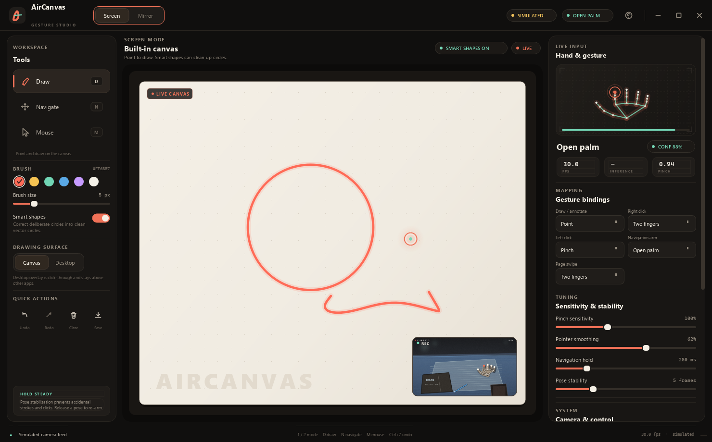
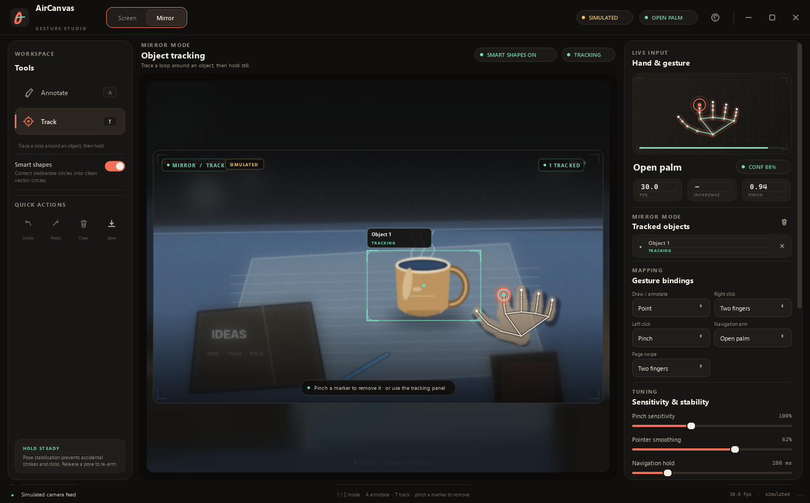
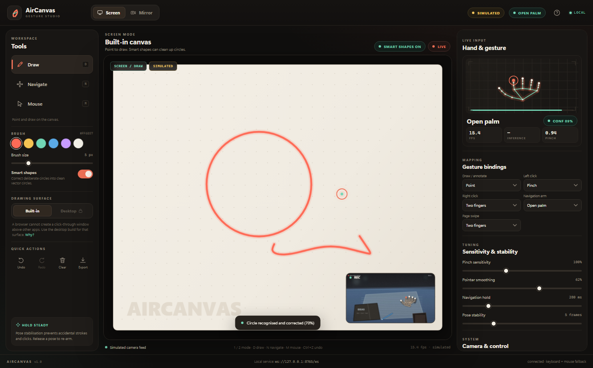
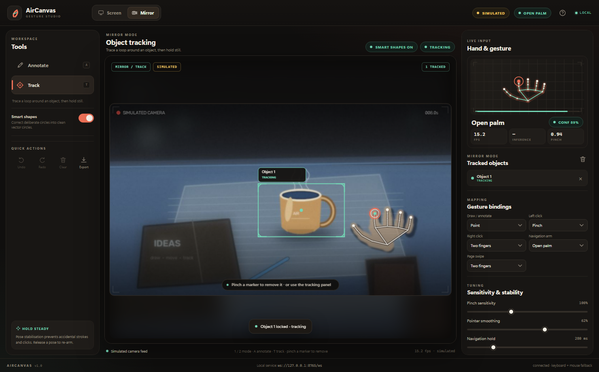
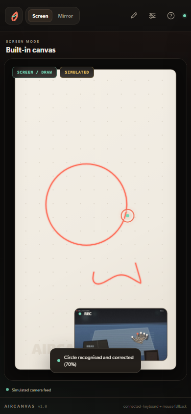
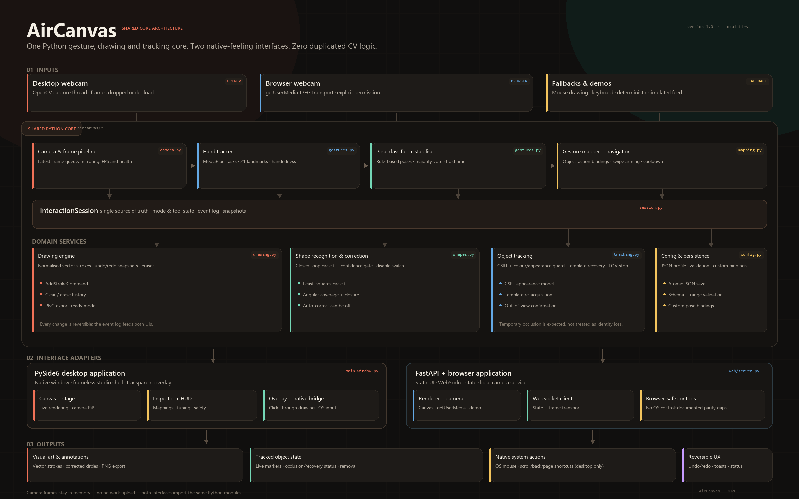

# AirCanvas

> **觸摸空氣，描繪世界。**
> 一套手勢控制的互動系統，具備網路攝影機手部追蹤、共用的 Python 核心、PySide6 桌面應用程式，以及 FastAPI 瀏覽器應用程式。

**語言：** [English](README.md) · 繁體中文 · 各文件的中文版為 [`docs/`](docs/) 內對應的 `*_CN.md` 檔案。

AirCanvas 是一套完整、以本機為優先（local-first）的手勢互動工作室。它把網路攝影機變成可直接操作的介面，用於繪圖、刻意的螢幕導覽、滑鼠控制、鏡像模式標註，以及以畫圈選取物件的追蹤。兩個介面執行相同的 Python 模組——手勢辨識、映射、繪圖、形狀校正、復原/重做與追蹤，絕不會在 JavaScript 中重新實作。



| 桌面版 · 鏡像模式 | 瀏覽器 · 螢幕模式 |
| --- | --- |
|  |  |
| **瀏覽器 · 鏡像模式** | **響應式瀏覽器版面** |
|  |  |

---

## 1. 內容一覽

| 需求 | 實作方式 |
| --- | --- |
| 螢幕繪圖 | 內建向量畫布**以及**可點擊穿透的透明桌面覆蓋層（桌面版），可於執行時切換 |
| 自動畫圓 | 保守的迴圈偵測、最小二乘圓擬合、可選的校正開關、復原安全的取代 |
| 螢幕導覽 | 張開手掌上/下/左/右滑動 + 兩指滑動切換上一頁/下一頁；姿勢穩定、手臂停留、冷卻時間，以及每次滑動僅觸發一次 |
| 滑鼠控制 | 經 One Euro 平滑的空中指標、捏合拖曳、兩指右鍵、點擊漣漪，以及在明確同意後的原生作業系統控制 |
| 鏡像標註 | 即時攝影機畫面，標註保留在視訊座標系統中；獨立的鏡像繪圖表面 |
| 物件選取/追蹤 | 指尖迴圈偵測器、按住鎖定、具外觀防護的 CSRT 追蹤器、遮蔽後的範本恢復、確認離開視野後終止、捏合/介面移除 |
| 桌面版介面 | PySide6 原生工作室外殼、無邊框視窗、工具列、檢視器（inspector）、引導流程、鍵盤快速鍵、透明覆蓋層 |
| 網頁版介面 | FastAPI + WebSocket + HTML/CSS/JavaScript、瀏覽器攝影機擷取、響應式畫布渲染器、瀏覽器內建控制項 |
| 手部模型選擇 | 內建 MediaPipe；選用 RTMPose-Hand（`rtmlib`）與自訂 21 特徵點 YOLO Pose（`.pt`），並提供可用性／錯誤狀態 |
| 共用核心 | `camera`、`gestures`、`hand_models`、`mapping`、`drawing`、`shapes`、`tracking`、`session`、`config`、`native`、`demo` |
| 人機互動（HCI） | 物件-動作映射、直接操作、復原/重做、防錯、通用可用性、格式塔（Gestalt）分組、引導流程，以及鍵盤/滑鼠替代方案 |
| 學術報告 | [架構](docs/ARCHITECTURE_CN.md) · [手勢對照表](docs/GESTURE_MAP_CN.md) · [介面比較](docs/INTERFACE_COMPARISON_CN.md) · [瀏覽器限制](docs/BROWSER_LIMITATIONS_CN.md) · [測試](docs/TESTING_CN.md) |
| 螢幕截圖 | `docs/screenshots/`（1480×920 桌面/網頁，另加 390×844 響應式檢視） |
| 架構圖 | `docs/architecture_diagram.png` |

內建具標籤的模擬攝影機影像饋送。它會驅動**真實**的 session、手勢穩定器、繪圖引擎、迴圈選取與 CSRT 追蹤器，且兩個介面皆可使用。這讓專案在沒有實體網路攝影機的情況下也能示範，並讓螢幕截圖對「哪些部分是模擬的」保持誠實。

---

## 2. 快速開始

> **本工作站：** 已驗證相機可用的是**全局 Python 3.15.1**，請用 `run_desktop_global.cmd` 或 `python run_desktop.py --camera-backend msmf` 啟動。下方的 venv 說明適用於乾淨機器；使用全局相機路徑時不要啟用 venv。相機裝置存取必須在程式代理沙箱之外執行。

### 需求條件

- Python **3.10–3.15**（最終相機路徑已於 Windows 11、全局 Python 3.15.1 測試；自動化測試較早於 Python 3.13.5 執行）
- 原生滑鼠/導覽與透明覆蓋層需要 Windows。繪圖、追蹤、網頁應用程式與核心可跨平台執行（未於 macOS/Linux 測試）。
- 網路攝影機為選用項目：請使用**模擬影像饋送（Simulated feed）**。
- 需連網一次，以安裝相依套件並下載 7.8 MB 的 MediaPipe 模型。此儲存庫已內附該模型於 `aircanvas/assets/hand_landmarker.task`。

### 建立並啟用虛擬環境 (不建議用)

使用 `uv`（建議方式，本次建置即以此建立）。如果 PowerShell 阻擋啟用，請先允許目前程序執行：

```powershell
Set-ExecutionPolicy -Scope Process -ExecutionPolicy Bypass
```

```powershell
uv venv --python 3.15 .venv
.\.venv\Scripts\Activate.ps1
uv pip install --python .\.venv\Scripts\python.exe -r requirements.txt
```

使用標準 Python：

```powershell
py -3.15 -m venv .venv
.\.venv\Scripts\Activate.ps1
python -m pip install --upgrade pip
python -m pip install -r requirements.txt
```

### 執行桌面應用程式

```powershell
python run_desktop.py
# 沒有攝影機？直接以具標籤的示範模式啟動：
python run_desktop.py --demo
# 以追蹤工具開啟鏡像模式：
python run_desktop.py --demo --mode mirror --tool track
```

### 執行網頁應用程式

```powershell
python run_web.py --open
# 若瀏覽器未開啟，請手動前往 http://127.0.0.1:8765/
```

瀏覽器應用程式預設由 `127.0.0.1` 提供服務。它透過 `getUserMedia` 使用瀏覽器攝影機；具標籤的模擬影像饋送只需點一下即可切換。攝影機存取需要**本機（localhost）或 HTTPS**，並須明確授予權限。

### 使用目前的全局 Python 3.15.1（本機建議）

全局直譯器已包含 PySide6 6.12、OpenCV 5.0 與 MediaPipe 1.2。這條路徑**不要啟用 venv**：

```powershell
python --version   # 應顯示 3.15.1
python run_desktop.py --camera-backend msmf --no-onboarding
# 或直接：
run_desktop_global.cmd
```

請在**一般 PowerShell／桌面工作階段**執行。程式代理的沙箱可能會封鎖攝影機裝置存取，即使全局 Python 本身可以使用。`run_desktop_global.cmd` 透過 `py` 啟動器選擇 Python 3.15（失敗時改用 `python`）、自動選擇 MSMF→DSHOW 後端並跳過引導流程。桌面版只需要 PySide6、OpenCV 與 MediaPipe；目前全局 Python **沒有** FastAPI/Uvicorn，若也要跑網頁版請使用 venv，或另外安裝這兩個套件。

Python 3.15 使用惰性（lazy）`concurrent.futures` 匯入；AirCanvas 已在 `aircanvas/gestures.py` 加入相容修正。`scripts/smoke_global_python.py` 可在不開攝影機的情況下驗證這個修正。

選用手部模型需另外安裝：`python -m pip install -r requirements-rtmpose.txt` 或 `python -m pip install -r requirements-yolo.txt`。

### 選擇手部特徵點模型

**System → Hand landmark model** 可在內建 **MediaPipe Hands**、**RTMPose-Hand**（透過 `rtmlib`）與自訂 **YOLO Pose (21-kp)** `.pt` 模型之間切換。狀態列會明確指出缺少哪個依賴或權重檔；AirCanvas 不會靜默後備。

```powershell
python run_desktop.py --hand-backend rtmpose
python run_desktop.py --hand-backend yolo_pose --hand-model models\hand-pose-21.pt
```

重要：RTMPose **body** m/l checkpoint 不是 21 特徵點手部模型。官方 YOLOv8/v11-pose 權重是 17 個 COCO 身體關鍵點；必須使用在手部資料集上訓練的自訂 21 特徵點模型。完整契約、安裝指令與限制請參見 [手部模型後端](docs/HAND_MODEL_BACKENDS_CN.md)。

### 桌面版攝影機無法開啟？

桌面應用程式現在會在 Windows 上依序嘗試 **Media Foundation → DirectShow → OpenCV 自動**，並驗證確實有真實影格送達。請執行：

```powershell
python scripts/diagnose_camera.py --max-index 3
```

若某個後端可用，請在 **System → Camera backend**（系統 → 攝影機後端）中選擇它，或在啟動前設定 `AIRCANVAS_CAMERA_BACKEND=msmf`（或 `dshow`）。若 OpenCV 看不到裝置但瀏覽器看得到，請改用網頁介面——瀏覽器影格會送到同一個本機 Python 核心，不需依賴 DirectShow/MSMF。參見[攝影機疑難排解](docs/CAMERA_TROUBLESHOOTING_CN.md)與 [USER_GUIDE_CN.md](docs/USER_GUIDE_CN.md)。

### 如有需要，重新下載手部模型

```powershell
python scripts/fetch_model.py
```

### 執行測試

```powershell
python -m pip install -r requirements-dev.txt
python -m pytest tests -q
```

此儲存庫包含 **52 項自動化測試**，涵蓋辨識、映射、攝影機與手部模型後端選擇、導覽安全性、復原/重做、追蹤恢復、共用 session、FastAPI WebSocket，以及一項桌面渲染冒煙測試。螢幕截圖腳本使用 Playwright；也可改以 `--cdp` 使用已開啟 `--remote-debugging-port` 的現有 Chrome。

---

## 3. 互動速查表

### 模式與工具

| 模式 | 工具 | 用途 |
| --- | --- | --- |
| **螢幕（Screen）** | 繪圖 · 導覽 · 滑鼠 | 內建畫布或透明桌面覆蓋層、刻意導覽、作業系統/虛擬滑鼠 |
| **鏡像（Mirror）** | 標註 · 追蹤 | 在網路攝影機畫面上繪圖，或畫圈選取物件以進行追蹤 |

### 手勢姿勢

| 姿勢 | 做出方式 | 主要用途 |
| --- | --- | --- |
| **指向（Point）** | 伸出食指，其餘手指彎曲 | 繪圖/標註；空中指標 |
| **捏合（Pinch）** | 拇指與食指指尖相觸（食指伸出） | 左鍵點擊/拖曳；移除標記 |
| **兩指（Two fingers）** | 伸出食指 + 中指 | 按住右鍵；上一頁/下一頁滑動 |
| **張開手掌（Open palm）** | 伸出四或五根手指 | 進入導覽待命；休息/取消意圖 |
| **握拳（Fist）** | 沒有伸出的手指 | 結束筆畫/釋放意圖 |

### 安全行為

- 姿勢必須通過多數表決（預設 **5 個影格**）才會生效。
- 導覽需要**張開手掌停留**（280 ms）、**最小位移**、**每次滑動僅觸發一次**，以及**冷卻時間**（1 秒）。
- 記錄作業系統輸入**預設為關閉**，且需要明確確認。瀏覽器端的作業系統控制刻意不提供。
- 清除畫布可復原；每一個繪圖動作都能反向還原。

### 鍵盤

| 按鍵 | 動作 |
| --- | --- |
| `1` / `2` | 螢幕 / 鏡像模式 |
| `D` / `N` / `M` | 繪圖 / 導覽 / 滑鼠 |
| `A` / `T` | 標註 / 追蹤 |
| `Ctrl+Z`、`Ctrl+Shift+Z` / `Ctrl+Y` | 復原 / 重做 |
| `Ctrl+S` | 匯出 PNG（頂層圖稿） |
| `F1` | 說明與手勢指南 |
| `Esc` | 在適用情況下關閉說明/抽屜/覆蓋層 |

只要繪圖（或標註）工具處於啟用狀態，就支援以滑鼠繪圖。這是沒有攝影機時的主要備援方式。

---

## 4. 架構概覽



```
網路攝影機 / 瀏覽器鏡頭 / 模擬影像饋送 / 滑鼠
                 │
                 ▼
        aircanvas.camera / 瀏覽器傳輸層
                 │
                 ▼
        HandTracker（MediaPipe Tasks）
                 │
                 ▼
    classify_hand → GestureStabilizer
                 │
                 ▼
        InteractionSession（單一真實來源）
        │        │         │          │
        │        │         │          └── ObjectTrackerManager（CSRT + 恢復）
        │        │         └───────────── DrawingEngine + ShapeRecognizer + 復原/重做
        │        └─────────────────────── NavigationController + MouseController
        └──────────────────────────────── GestureMapper / config / 事件
                 │
        ┌────────┴─────────┐
        ▼                  ▼
  PySide6 桌面版      FastAPI WebSocket
  Canvas · 覆蓋層     Canvas · 攝影機影格
  原生 OS 橋接        瀏覽器安全動作
```

關鍵界線：

- **共用的 Python 模組**負責所有辨識、映射、繪圖、形狀校正、追蹤、復原/重做與狀態。
- **PySide6** 負責原生視窗、透明覆蓋層、原生作業系統橋接與原生回饋。
- **FastAPI/JS** 負責瀏覽器攝影機擷取與畫布渲染；它送出語意化指令並接收狀態，絕不重複實作電腦視覺（CV）邏輯。
- 完整的網頁協定記錄於 [ARCHITECTURE_CN.md](docs/ARCHITECTURE_CN.md)。

瀏覽器 UI 採用小型 Vue 風格、無需建置的結構：`core/`（state、常數、DOM bridge）、`features/`（相機、設定、snapshot view-model）、`render/`（Canvas 2D 舞台與手部預覽）、`ui/`（模式／工具呈現），以及精簡的 `app.js` 外殼。CSS 依職責拆分於 `styles/`。

原始碼樹簡介：

```
aircanvas/
├── camera.py          OpenCV 擷取、最新影格佇列、管線
├── gestures.py        MediaPipe tasks 封裝、姿勢規則、穩定器
├── mapping.py         手勢→動作映射、導覽 + 虛擬滑鼠
├── drawing.py         可逆的向量筆畫引擎
├── shapes.py          迴圈辨識、圓擬合、選取偵測器
├── tracking.py        CSRT + 外觀防護 + 恢復 + 視野（FOV）狀態機
├── session.py         共用協調、事件、快照
├── hand_models.py     可選的 MediaPipe / RTMPose / YOLO 後端
├── config.py          經驗證、可 JSON 序列化的設定
├── native.py          Windows 游標 / 點擊 / 鍵盤橋接
├── demo.py            確定性的具標籤模擬攝影機
├── desktop/           PySide6 介面（舞台、元件、覆蓋層、對話框）
└── web/               FastAPI 服務 + 靜態 HTML/CSS/JS 介面
    └── static/        index.html · app.js 入口 · src/{core,features,render,ui} · styles/
aircanvas/assets/hand_landmarker.task
tests/                 52 項自動化測試
docs/                  架構、手勢對照表、比較、測試、螢幕截圖
scripts/               螢幕截圖、架構圖、模型下載
```

逐檔說明請參見 [PROJECT_STRUCTURE_CN.md](docs/PROJECT_STRUCTURE_CN.md)。

---

## 5. 文件導覽

| 文件 | 用途 |
| --- | --- |
| [ARCHITECTURE_CN.md](docs/ARCHITECTURE_CN.md) | 模組、資料流、座標模型、執行緒、追蹤狀態機、WebSocket 協定 |
| [GESTURE_MAP_CN.md](docs/GESTURE_MAP_CN.md) | 完整手勢詞彙、情境映射、閾值、自訂方式、鍵盤替代方案 |
| [HAND_MODEL_BACKENDS_CN.md](docs/HAND_MODEL_BACKENDS_CN.md) | MediaPipe、RTMPose-Hand 與 YOLO Pose 的選擇、模型契約、安裝與限制 |
| [INTERFACE_COMPARISON_CN.md](docs/INTERFACE_COMPARISON_CN.md) | 桌面版與網頁版的學術比較、功能矩陣、HCI 分析、啟發式評估、實測效能 |
| [BROWSER_LIMITATIONS_CN.md](docs/BROWSER_LIMITATIONS_CN.md) | 瀏覽器安全限制與功能差異，附證據與替代做法 |
| [CAMERA_TROUBLESHOOTING_CN.md](docs/CAMERA_TROUBLESHOOTING_CN.md) | DSHOW/FFMPEG/Obsensor 攝影機訊息的完整內容、後端/索引診斷，以及瀏覽器備援方案 |
| [TESTING_CN.md](docs/TESTING_CN.md) | 自動化 + 手動測試程序、環境證據、可用性檢查清單 |
| [USER_GUIDE_CN.md](docs/USER_GUIDE_CN.md) | 給終端使用者的引導流程與疑難排解 |
| [KNOWN_LIMITATIONS_CN.md](docs/KNOWN_LIMITATIONS_CN.md) | 已知限制與依優先順序排列的未來改善項目 |
| [DELIVERABLES_CN.md](docs/DELIVERABLES_CN.md) | 每一項要求的交付項目與其對應檔案的對照表 |

---

## 6. 測試與環境證據

本專案在 Windows 11 上建立並驗證。**完整 52 項測試套件使用全局 Python 3.15.1** 執行（PySide6 6.12、OpenCV 5.0、MediaPipe 1.2）；螢幕截圖與較早的效能基準使用相同程式碼。程式代理沙箱會封鎖相機裝置存取，因此最終相機驗證是在非沙箱環境執行。

1. 全局 Python 3.15.1 + 實體網路攝影機：**MSMF**、1280×720、約 4 秒處理 **103 幀（31.5 FPS）**、辨識 **17.3 ms**，無 `recognition_error`。
2. MediaPipe 手部特徵點模型也在真實手部照片（960×640）上執行：偵測到一隻手、21 個特徵點、`open_palm`；CPU 上每影格平均 **15.8 ms**（p95 17.2 ms）。
3. 兩個介面都以確定性的模擬影像饋送渲染，其使用相同的 session、繪圖引擎與追蹤器。
4. 瀏覽器攝影機傳輸以合成的 `MediaStream` 演練，以驗證權限、擷取、JPEG 傳輸與狀態流程。

全部 52 項自動化測試皆在全局 Python 3.15.1 下通過。精確指令與手動驗收清單請參見 [TESTING_CN.md](docs/TESTING_CN.md)。

---

## 7. 隱私與安全

- 影格由本機的 Python 程序/服務在記憶體中處理。AirCanvas **不會上傳**或儲存這些影格。
- 網頁服務預設綁定於回送位址（`127.0.0.1`），會檢查 WebSocket 來源、強制套用 CSP，並限制影格/訊息大小。
- 作業系統的滑鼠與導覽控制在使用者確認警告前皆為停用。瀏覽器 session 無法啟用它們。
- 瀏覽器無法在其他應用程式之上建立透明視窗。該能力刻意僅限桌面版；參見 [BROWSER_LIMITATIONS_CN.md](docs/BROWSER_LIMITATIONS_CN.md)。
- 模擬影像饋送在兩個介面中都明確標示 `SIMULATED`。

---

## 8. 第三方聲明

- [MediaPipe](https://developers.google.com/mediapipe)（Apache-2.0）提供手部特徵點模型。內附的 `aircanvas/assets/hand_landmarker.task` 取自 Google 的模型儲存空間。
- [OpenCV](https://opencv.org/) 提供擷取、影像處理與 CSRT 追蹤器。
- [PySide6](https://doc.qt.io/qtforpython-6/) / Qt 提供桌面版介面。
- [FastAPI](https://fastapi.tiangolo.com/)、[Uvicorn](https://www.uvicorn.org/) 與 Starlette 提供網頁服務。
- One Euro 濾波器依循 Casiez、Roussel & Vogel（2012）。
- CSRT 追蹤器依循 Lukežič 等人（2018）。

本專案為學術專案。若要在課程範圍外重新散布，請自行確認授權。
