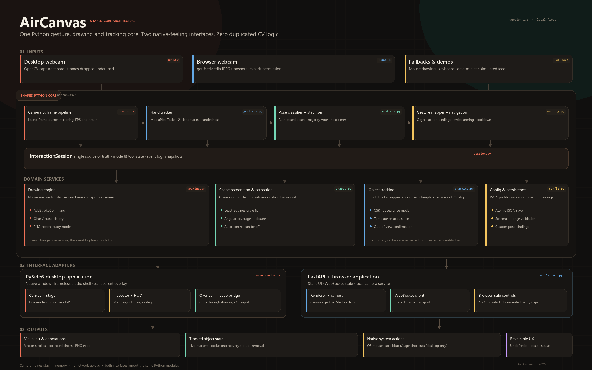

# AirCanvas — System Architecture

**Version:** 1.0  
**Scope:** shared Python core, PySide6 desktop shell, FastAPI browser shell, real-time data flow and extension points.  
**Diagram:** [`architecture_diagram.png`](architecture_diagram.png)

---

## 1. Architectural goal

AirCanvas has one rule that overrides convenience: **recognition, mapping, drawing, shape correction, tracking and undo/redo live in the shared Python core**. The desktop and browser interfaces are adapters around the same `InteractionSession`. This is not only a maintainability claim; it is verifiable from the imports:

- `aircanvas/desktop/main_window.py` imports `InteractionSession` and calls `process_frame`, `snapshot`, `undo`, `redo` and `manual_begin/add/end`.
- `aircanvas/web/server.py` creates one `InteractionSession` per WebSocket and calls exactly the same methods.
- No JavaScript file contains a gesture classifier, stroke engine, shape fitter or tracker. `app.js` renders the state returned by Python and captures camera frames.

The two interfaces therefore share the same gesture thresholds, gesture stabiliser, circle fit, navigation state machine, CSRT setup, occlusion policy and configuration schema.

---

## 2. Layered view



| Layer | Components | Responsibilities |
| --- | --- | --- |
| **Capture / input** | `OpenCVCamera`, `CameraPipeline`, browser `getUserMedia` + JPEG transport, `DemoEngine` | Obtain frames, drop stale frames, mirror before inference, maintain FPS/health |
| **Perception** | `HandTracker`, `classify_hand`, `GestureStabilizer` | MediaPipe Tasks hand landmarks, rule-based static poses, temporal majority vote |
| **Mapping / intent** | `GestureMapper`, `NavigationController`, `MouseController`, `LoopSelectionDetector` | Turn poses and motion into semantic actions without executing UI-specific side effects |
| **Domain services** | `DrawingEngine`, `ShapeRecognizer`, `ObjectTrackerManager`, `Undo/Redo` | Vector storage, circle recognition, reversible history, object tracking and recovery |
| **Orchestration** | `InteractionSession`, `AppConfig` | State, mode/tool lifecycle, event log, snapshots, thread-safe coordination |
| **Adapters** | PySide6 shell, FastAPI/WebSocket, `NativeInputBridge`, overlay windows | Render state, transport frames, execute platform-specific actions |
| **Outputs** | Canvas, camera overlay, markers, PNG, native cursor/navigation | User-visible results and reversible feedback |

The diagram deliberately places the interface adapters *outside* the shared core. Replacing PySide6 with another toolkit or FastAPI with another transport would not change a gesture threshold or tracker policy.

---

## 3. Module responsibilities

### 3.1 Shared core

| Module | Key classes / functions | Why it exists |
| --- | --- | --- |
| `aircanvas/camera.py` | `OpenCVCamera`, `CameraInfo`, `CameraPipeline`, `list_cameras`, `camera_backend_candidates`, `diagnose_cameras` | Desktop capture thread, latest-frame queue, MSMF→DSHOW→ANY backend fallback, open/read validation, status and camera failure messages. The web equivalent is browser capture + WebSocket transport because servers cannot access the client's camera. |
| `aircanvas/gestures.py` | `HandTracker`, `classify_hand`, `GestureStabilizer`, `detect_fingers` | MediaPipe Tasks implementation, landmark features, pose rules and temporal stability; includes a Python 3.15/PySide lazy-`concurrent.futures` compatibility pin. |
| `aircanvas/hand_models.py` | `HandLandmarkBackend`, `MediaPipeBackend`, `RTMPoseHandBackend`, `YOLOPoseBackend`, `backend_catalog`, `create_hand_backend` | Pluggable 21-keypoint provider contract. Lazy optional RTMPose (`rtmlib`) and YOLO Pose (`ultralytics`) adapters; availability/reason reporting without silently replacing the selected model. |
| `aircanvas/mapping.py` | `GestureMapper`, `NavigationController`, `MouseController`, `NavAction` | Maps semantic poses to roles. Navigation contains the arming/cooldown state machine; mouse control contains click/drag/right-click logic but **does not call the OS**. |
| `aircanvas/drawing.py` | `DrawingEngine`, `DrawCommit` | Normalised vector strokes, brush style, eraser, clear, undo/redo snapshots, shape-correction commit. |
| `aircanvas/shapes.py` | `recognize_shape`, `fit_circle`, `LoopSelectionDetector` | Conservative circle fitting and the two-phase loop selection gesture. |
| `aircanvas/tracking.py` | `SingleObjectTracker`, `ObjectTrackerManager`, `TrackerParams` | CSRT tracking, colour/appearance consistency, template recovery, occlusion and out-of-view states. |
| `aircanvas/session.py` | `InteractionSession` | The façade/orchestrator. Owns active mode/tool, two drawing engines, navigation/mouse controllers, tracker and event log. Produces serialisable snapshots. |
| `aircanvas/config.py` | `AppConfig`, `GestureSettings`, `load_config`, `save_config` | JSON-serialisable, validated configuration. Used identically by both interfaces. |
| `aircanvas/native.py` | `NativeInputBridge` | Windows `SetCursorPos`, mouse events, wheel and keyboard shortcuts. Called only by the desktop and only after explicit consent. |
| `aircanvas/demo.py` | `DemoEngine`, `DemoPipeline` | Labelled deterministic camera scene and scripted landmarks. Drives the real session/tracker; it is not a second implementation. |
| `aircanvas/synthetic.py` | `synthetic_hand`, `hand_with_index_tip` | Test/demo landmark generation for all static poses. |
| `aircanvas/smoothing.py` | `OneEuroFilter`, `PointerSmoother`, `HoldStabilizer` | Adaptive pointer filtering and temporal helpers. |
| `aircanvas/geometry.py` | `Point`, `BBox`, circle/segment helpers | Normalised-coordinate geometry. |

### 3.2 Desktop adapter

| File | Responsibility |
| --- | --- |
| `desktop/app.py` | CLI parsing, high-DPI policy, theme, session/window bootstrap |
| `desktop/main_window.py` | Native studio shell, toolbar, inspector, settings, camera/demo lifecycle, keyboard shortcuts, native-event routing, export |
| `desktop/stage.py` | Central QPainter renderer for canvas/video, strokes, hand skeleton, markers, selection, cursor, nav HUD, PiP, artwork export |
| `desktop/overlay.py` | Full-screen click-through transparent canvas plus a separate interactive floating toolbar |
| `desktop/widgets.py` | Accessible custom widgets: segmented control, icon buttons, toggles, sliders, gesture badge, hand preview, toast |
| `desktop/icons.py` | QPainter vector icons, no external icon dependency |
| `desktop/dialogs.py` | Onboarding, help and OS-control safety confirmation |
| `desktop/theme.py` | Warm dark design tokens and application stylesheet |

The desktop `CameraPipeline` captures and processes on background threads. A 33 ms `QTimer` polls rendered RGB frames/snapshots to the UI; no MediaPipe or CSRT work runs on the Qt event loop. The stage renders camera and overlay elements in QPainter rather than baking them into the JPEG/numpy frame, so the drawing remains crisp at any DPI.

### 3.3 Web adapter

| File | Responsibility |
| --- | --- |
| `web/server.py` | FastAPI app, HTTP endpoints, WebSocket session, origin/CSP protections, frame decode, demo scheduling, per-client `InteractionSession` |
| `web/static/index.html` | Semantic shell, accessible controls, inline SVG icon sprite, welcome/help/security dialogs |
| `web/static/app.js` | Thin entrypoint: initialization, WebSocket connection, event bindings, keyboard shortcuts and cleanup |
| `web/static/src/core/` | Constants, state store, DOM/UI primitives, transport bridge, pure helpers |
| `web/static/src/render/` | Canvas 2D stage, hand preview and PNG export; no recognition logic |
| `web/static/src/features/` | Camera/demo capture, config sync and snapshot view-model |
| `web/static/src/ui/` | Mode/tool presentation and toolbar state |
| `web/static/styles/` | Split design system: base, layout, stage, inspector, components and responsive rules |

The browser is responsible for camera capture because `getUserMedia` belongs to the client. It mirrors frames in a capture canvas when the mirror setting is enabled, so the JPEG coordinates sent to Python match what the user sees. The backend returns only semantic state; annotated drawings are re-rendered in the browser from that state, keeping strokes vector-sharp.

---

## 4. Runtime data flow

### 4.1 Desktop camera pipeline

```text
OpenCVCamera thread
  read() → latest frame (drops older frames)
       │
CameraPipeline thread
  mirror if configured → InteractionSession.process_frame(frame, now)
       │                    ├─ HandTracker.detect()
       │                    ├─ classify_hand → GestureStabilizer
       │                    ├─ update mode/tool action
       │                    ├─ update DrawingEngine / tracker
       │                    └─ append semantic UiEvents
       │
  snapshot + RGB frame → thread-safe latest result
       │
Qt QTimer (33 ms)
  ├─ StageWidget/QPainter render
  ├─ inspector labels, hand preview, tracking list
  ├─ native mouse/navigation events (if consented)
  └─ overlay window update
```

### 4.2 Web camera flow

```text
Browser video element
  hidden capture canvas (mirrored if configured) → JPEG data URL
       │ WebSocket {type:"frame", image:...}  ~12 fps
       ▼
FastAPI WebSocket handler
  decode JPEG → to_thread(InteractionSession.process_frame)
       │ snapshot + event list
       ▼
Browser receives {type:"state", state:{...}}
  ├─ Canvas 2D renderer draws paper/feed, strokes, skeleton, markers, cursor
  ├─ inspector / tracking list / live status update
  └─ camera frames remain local; no image is echoed
```

### 4.3 Web demo flow

The browser may request `{type:"demo", enabled:true, seek:...}`. The server creates a `DemoEngine`, optionally pre-rolls it, then schedules a 15 fps task. Each tick generates a labelled 960×540 scene and synthetic 21-point hand, calls `session.process_frame`, JPEG-encodes the scene, and sends state + frame. Because the same session is used, tracking, drawing and shape correction behave exactly as in camera mode.

---

## 5. Coordinate model

All shared interaction coordinates are normalised to `[0, 1]` in the source frame or canvas.

- **Camera:** hand landmarks, pointer, selection loops and track boxes are normalized to the frame sent for processing. Frames are mirrored *before* inference, so landmarks, the visible video and annotations all share one origin.
- **Screen canvas:** pointer and strokes are normalized to the active stage rectangle. The browser and desktop each map that rectangle to their own DPI-independent pixels.
- **Drawing surfaces:** screen and mirror have separate `DrawingEngine` instances. Switching mode preserves the other surface. Both serialize to the same schema.
- **Display aspect:** corrected circles are rendered as physical circles from their bounding rectangle. This keeps a “smart circle” round even when the display rectangle is not square. Circle recognition remains conservative and accepts ellipses up to 1.9:1, which corresponds to drawing on a 16:9 video surface.
- **Tracking:** track boxes and selection regions are normalized to the camera frame. The renderer maps them back to the displayed video rectangle.

---

## 6. State, events and snapshots

`InteractionSession.snapshot()` returns a JSON-native document consumed by both UIs:

```json
{
  "version": "1.0",
  "mode": "mirror",
  "tool": "draw",
  "mirror_tool": "track",
  "active_tool": "track",
  "config": { "...": "validated AppConfig" },
  "hand": { "visible": true, "landmarks": [[0.51, 0.42]], "handedness": "Right" },
  "gesture": { "raw": "open_palm", "stable": "open_palm", "held_s": 1.2 },
  "pointer": { "x": 0.52, "y": 0.43, "visible": true, "pressed": false },
  "drawing": { "strokes": [], "current": null, "can_undo": true },
  "tracks": [{ "id": 1, "bbox": [0.4, 0.4, 0.2, 0.2], "status": "tracking" }],
  "nav": { "armed": false, "progress": 0.2, "hint": "Hold to arm navigation" },
  "selection": { "active": true, "points": [], "progress": 0.6 },
  "camera": { "status": "live", "source": "opencv" },
  "status": { "message": "...", "tracking": { "...": "..." }, "toast": null },
  "stats": { "fps": 30.0, "recognition_ms": 15.8 },
  "events": [ { "id": 12, "kind": "shape_corrected", "data": {} } ]
}
```

Event kinds include `shape_corrected`, `click`, `mouse_left_down`, `mouse_left_up`, `mouse_right_click`, `navigation`, `track_added`, `track_occluded`, `track_recovered`, `track_lost`, `track_out_of_view`, `track_removed`, `undo`, `redo` and `cleared`.

- The desktop uses the returned event list to execute native actions (never the repeated snapshot events).
- The web uses event IDs for click ripples and status feedback; it must not execute OS actions.
- All shared methods use an `RLock`, so the UI thread and processing thread can call them safely.

---

## 7. Gesture pipeline and safety layers

```text
MediaPipe hand landmarks (21)
        │
        ├─ finger extension: joint angles + distance-to-wrist checks
        ├─ thumb-index distance / palm scale → pinch ratio
        └─ rule decision → raw pose (point / pinch / two fingers / open palm / fist / three)
        │
GestureStabilizer (majority window, default 5 frames, hold duration)
        │
Context gate (mode + active tool)
        │
Role mapping (draw_pose, click_pose, right_click_pose, nav_pose, page_pose)
        │
Action-specific safety:
  draw:      stable pose required; stroke ends on pose change/loss
  mouse:     stable click pose; right-click hold timer; release on tool loss
  navigate:  hold-to-arm, anchor reset during arming, threshold, one shot, cooldown
  track:     fingertip loop closure + angular coverage + dwell; pinch marker removal
```

The pose layer is intentionally rule-based. It is explainable, CPU-light, customisable and does not require a training pipeline. MediaPipe only supplies landmarks; AirCanvas owns the semantic gesture rules.

---

## 8. Drawing, shape correction and undo/redo

`DrawingEngine` stores `Stroke` objects in normalised coordinates:

```text
Stroke(id, points[], color, width, kind, closed, corrected)
```

- A live stroke is outside history until committed.
- Committing a stroke pushes a deep snapshot of the previous stroke list; undo/redo swap snapshots. Clear, erase and remove are equally reversible.
- When `auto_shapes` is enabled, the committed polyline is passed to `recognize_shape`.
- Circle acceptance requires minimum length, closure (including natural overshoot), angular coverage, circularity, aspect ratio and a least-squares fit confidence.
- A corrected stroke is replaced by 96 parametric points and marked `kind="circle"`, `corrected=True`. Renderers draw it as a true physical circle.
- No shape detection runs on open arcs or very small scribbles.
- The setting can be switched off at runtime; existing corrected strokes stay corrected (they are already committed), new strokes stay freehand.

The loop selection detector reuses the same geometric primitives but a different policy: it must be an intentional region gesture, not a shape correction. It requires a minimum path length, loop closure, angular coverage and a hold period before emitting a selection bbox.

---

## 9. Object tracking state machine

```text
              loop selection + hold
                        │
                        ▼
                   [ tracking ] ──────────────┐
                    │        ▲                │
        appearance drop │    │ template match │
                    ▼        │                │
                [ occluded ]─┘                │
                    │                         │
        timeout / repeated miss              │ confirmed edge exit
                    ▼                         ▼
                 [ lost ]               [ out_of_view ]
```

- **Initialise:** selection bbox is inset and initialised into CSRT. Appearance is stored as an HSV histogram and a zero-normalised grayscale template.
- **Track:** CSRT proposes a box. The candidate must maintain appearance similarity and plausible motion continuity.
- **Guard:** a uniform hand/lens-cap occluder can make CSRT confident; the appearance correlation gate rejects that and triggers recovery.
- **Recover:** a local template search around the predicted/velocity-shifted location can reinitialise CSRT after a short occlusion. Recovery must also pass appearance validation.
- **Occluded:** after repeated misses the marker is amber and the engine keeps searching for a bounded timeout.
- **Out of view:** if the failed tracker remains at the frame edge for several consecutive frames, the object is confirmed to have left; tracking stops and the UI states “left camera view”.
- **Manual removal:** pinch over a marker bbox or use the remove button in the tracking list.
- **Limits:** a tracker is always an appearance model, not semantic object identity. Fast scale changes, identical-looking objects and long occlusions beyond the timeout can lose it.

---

## 10. WebSocket protocol

Endpoint: `/ws` on the local FastAPI service.

### Client → server

| Type | Payload | Purpose |
| --- | --- | --- |
| `hello` | `config` | Apply initial mode/tool/gesture configuration |
| `frame` | `image` (JPEG data URL), `ts` | Browser camera frame, ~12 fps |
| `config` | `patch` (partial `AppConfig`) | Gesture mapping, tuning, mirror, landmark, left-handed |
| `mode` | `value: screen\|mirror` | Change mode through the shared lifecycle |
| `tool` | `value: draw\|navigate\|mouse\|annotate\|track` | Change active tool |
| `pointer` | `phase: start\|move\|end`, `x`, `y` | Mouse/touch drawing into the shared engine |
| `action` | `name: undo\|redo\|clear\|clear_tracks\|remove_track\|pause\|set_brush`, plus params | Reversible actions |
| `demo` | `enabled`, optional `seek` (0–20 s) | Start/stop the labelled simulated feed |
| `camera_status` | `status`, `message`, `width`, `height` | Browser permission/error/live state |
| `request_state` | — | Force a snapshot |
| `ping` | `t` | Liveness |

### Server → client

| Type | Payload | Purpose |
| --- | --- | --- |
| `ready` | version, config, features, limits | Capability handshake |
| `configured` | config, features | Configuration applied |
| `state` | `seq`, `state`, optional `frame`, features | Authoritative state; demo frames are JPEG data URLs |
| `error` | message | Recoverable protocol/frame error |
| `pong` | `t` | Liveness |

Security controls:

- Bind to loopback by default; no authentication is assumed.
- WebSocket origin host must be `localhost`, `127.0.0.1` or `::1`.
- Frames are capped at 2.5 MB and messages at 3.5 MB; dimensions are validated.
- CSP restricts scripts/styles/connections; camera is allowed for self only via `Permissions-Policy`.
- OS control is forced off in web sessions regardless of client config.
- No frame is written to disk.

---

## 11. Threading and performance

| Interface | Capture | Inference | UI |
| --- | --- | --- | --- |
| Desktop | Dedicated `OpenCVCamera` thread, drops stale frames | Dedicated `CameraPipeline` thread | Qt main thread, 33 ms polling, QPainter |
| Web | Browser capture interval | FastAPI handler `asyncio.to_thread` per frame | Browser `requestAnimationFrame` canvas |

Why frames are dropped rather than queued: latency matters more than processing every frame. The desktop pipeline reads the newest available frame each loop. The web service processes each received frame sequentially and the browser checks `bufferedAmount`/connection state before sending.

Measured on the build machine (Windows 11, CPU; inference benchmark on Python 3.13.5, final camera run on global Python 3.15.1):

- Real webcam with global Python 3.15.1: **31.5 FPS** and **17.3 ms** recognition at 1280×720 through MSMF.
- MediaPipe hand landmarker on a real 960×640 hand photo: **15.8 ms mean**, **17.2 ms p95** → ~63 FPS recognition headroom.
- Demo session throughput including scene generation and tracking: **25.6 FPS** (150 frames in 5.86 s).
- Web demo stream: 15 FPS target, 960×540 JPEG; browser canvas at display refresh rate.
- Desktop UI timer: 30 Hz; drawing vectors are rendered by QPainter, not re-encoded.

Actual webcam FPS depends on resolution, MediaPipe initialization and hardware. The first webcam frame also pays a one-time model load of roughly 1.2 s.

---

## 12. Error handling and recovery

- **No camera / permission denied:** the UI exposes Retry camera and Simulated feed, with a human-readable cause. The web service accepts a browser `camera_status` error.
- **Missing model:** `HandTracker.initialize()` raises a clear `FileNotFoundError`; the interface remains usable with mouse drawing and a toast explains how to restore the model.
- **Camera disconnect:** `OpenCVCamera` retries reads; after repeated failures the status becomes error. The pipeline thread exits cleanly on stop.
- **Tracker failure:** `ObjectTrackerManager` catches tracker exceptions, marks the marker lost and keeps the UI responsive.
- **Malformed frame/message:** WebSocket returns an `error` and continues; oversized/unsupported images are rejected.
- **Native click stuck:** tool changes, mode changes and app shutdown call `release_all()` to send a left-button-up.
- **Undo after clear:** clear is a normal snapshot command, so it can be reversed.
- **Configuration error:** `AppConfig.from_dict` validates unknown/invalid values and falls back to defaults.

---

## 13. Extensibility

The architecture makes the following extensions local rather than cross-cutting:

| Extension | Where to add it |
| --- | --- |
| New pose | `gestures.classify_hand`, `GESTURE_OPTIONS` and one mapping role |
| New drawn shape | `shapes.recognize_shape` returning a new `kind`; renderer branch |
| New tracker | Implement the `SingleObjectTracker` interface or swap `ObjectTrackerManager` |
| New camera source/backend | Add a source behind `OpenCVCamera` or extend `CameraPipeline` |
| New native action | Add to `NativeInputBridge`, emit a semantic event from core |
| New UI | Consume `InteractionSession.snapshot()` and the documented event vocabulary |
| New transport | Reuse the same state/event schema over REST/gRPC/another WebSocket |

No interface owns domain state. Adding a third front-end cannot fork gesture thresholds or undo semantics unless it deliberately bypasses the core.

---

## 14. Design patterns in use

- **Facade / orchestrator:** `InteractionSession` hides the coordination of six domain services.
- **Strategy:** capture source (camera vs demo), tracker backend, pointer filter settings.
- **State machines:** navigation arming, mouse click/drag/right-click, tracker occlusion/out-of-view, demo script.
- **Command / memento hybrid:** snapshot-based undo/redo for vector drawing.
- **Observer:** semantic event log and snapshots consumed by UI adapters.
- **Adapter:** PySide6 stage/overlay and browser canvas both adapt the same state to platform rendering.
- **Value objects:** normalised `Point`, `BBox`, `Stroke`, `AppConfig`.

---

## 15. Related documents

- [Gesture mapping table](GESTURE_MAP.md)
- [Desktop vs web comparison](INTERFACE_COMPARISON.md)
- [Browser limitations](BROWSER_LIMITATIONS.md)
- [Testing procedures](TESTING.md)
- [Project structure](PROJECT_STRUCTURE.md)
