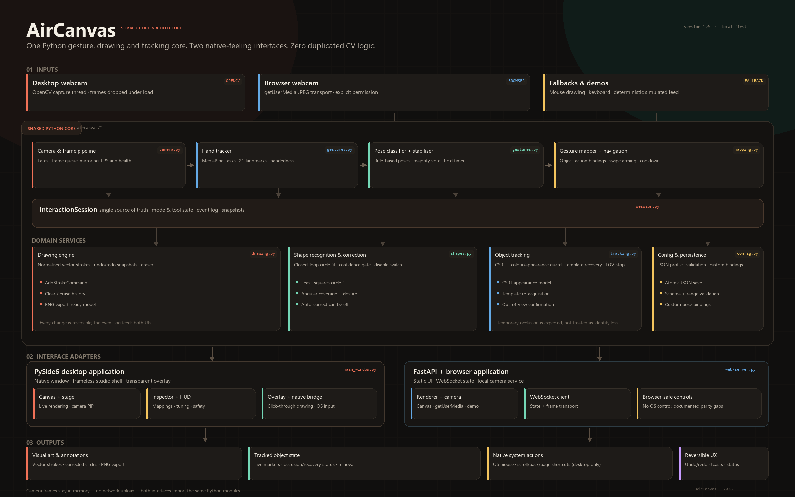

# AirCanvas — 系統架構

**版本：** 1.0  
**範圍：** 共用 Python 核心、PySide6 桌面外殼、FastAPI 瀏覽器外殼、即時資料流與擴充點。  
**圖示：** [`architecture_diagram.png`](architecture_diagram.png)

---

## 1. 架構目標

AirCanvas 有一條凌駕於便利性之上的規則：**辨識、對應、繪圖、形狀矯正、追蹤與復原／重做全都位於共用的 Python 核心**。桌面與瀏覽器介面都只是同一個 `InteractionSession` 外圍的轉接器。這不只是可維護性的宣稱，而是可以從匯入（import）關係驗證的：

- `aircanvas/desktop/main_window.py` 匯入 `InteractionSession`，並呼叫 `process_frame`、`snapshot`、`undo`、`redo` 與 `manual_begin/add/end`。
- `aircanvas/web/server.py` 為每個 WebSocket 建立一個 `InteractionSession`，並呼叫完全相同的方法。
- 沒有任何 JavaScript 檔案包含手勢分類器、筆畫引擎、形狀擬合器或追蹤器。`app.js` 只負責渲染 Python 回傳的狀態，並擷取攝影機影格。

因此兩個介面共用相同的手勢門檻、手勢穩定器、圓形擬合、導覽狀態機、CSRT 設定、遮蔽策略與設定結構定義（config schema）。

---

## 2. 分層視圖



| 分層 | 元件 | 職責 |
| --- | --- | --- |
| **擷取 / 輸入** | `OpenCVCamera`、`CameraPipeline`、瀏覽器 `getUserMedia` + JPEG 傳輸、`DemoEngine` | 取得影格、丟棄過期影格、在推論前進行鏡像、維持 FPS／健康狀態 |
| **感知** | `HandTracker`、`classify_hand`、`GestureStabilizer` | MediaPipe Tasks 手部特徵點、基於規則的靜態姿態、時間上的多數投票 |
| **對應 / 意圖** | `GestureMapper`、`NavigationController`、`MouseController`、`LoopSelectionDetector` | 將姿態與動作轉為語義動作，而不執行任何介面專屬的副作用 |
| **領域服務** | `DrawingEngine`、`ShapeRecognizer`、`ObjectTrackerManager`、`Undo/Redo` | 向量儲存、圓形辨識、可逆的歷史、物件追蹤與回復 |
| **協調** | `InteractionSession`、`AppConfig` | 狀態、模式／工具生命週期、事件日誌、快照、執行緒安全協調 |
| **轉接層** | PySide6 外殼、FastAPI／WebSocket、`NativeInputBridge`、覆蓋視窗 | 渲染狀態、傳輸影格、執行平台專屬動作 |
| **輸出** | 畫布、攝影機覆蓋層、標記、PNG、原生游標／導覽 | 使用者可見的結果與可逆的回饋 |

此圖刻意將介面轉接器放在共用核心*之外*。以其他工具組取代 PySide6，或以其他傳輸方式取代 FastAPI，都不會改變任何手勢門檻或追蹤器策略。

---

## 3. 模組職責

### 3.1 共用核心

| 模組 | 主要類別 / 函式 | 存在原因 |
| --- | --- | --- |
| `aircanvas/camera.py` | `OpenCVCamera`、`CameraInfo`、`CameraPipeline`、`list_cameras`、`camera_backend_candidates`、`diagnose_cameras` | 桌面擷取執行緒、最新影格佇列、MSMF→DSHOW→ANY 後端後備（fallback）、開啟／讀取驗證、狀態與攝影機失敗訊息。網頁端的對等做法是瀏覽器擷取 + WebSocket 傳輸，因為伺服器無法存取用戶端的攝影機。 |
| `aircanvas/gestures.py` | `HandTracker`、`classify_hand`、`GestureStabilizer`、`detect_fingers` | MediaPipe Tasks 實作、特徵點資料、姿態規則與時間穩定性；包含 Python 3.15／PySide 惰性 `concurrent.futures` 相容修正。 |
| `aircanvas/hand_models.py` | `HandLandmarkBackend`、`MediaPipeBackend`、`RTMPoseHandBackend`、`YOLOPoseBackend`、`backend_catalog`、`create_hand_backend` | 可插拔的 21 特徵點提供者契約。惰性載入選用 RTMPose（`rtmlib`）與 YOLO Pose（`ultralytics`）轉接器；回報可用性與原因，不會靜默替換所選模型。 |
| `aircanvas/mapping.py` | `GestureMapper`、`NavigationController`、`MouseController`、`NavAction` | 將語義姿態對應到角色。導覽包含待命（arming）／冷卻狀態機；滑鼠控制包含點擊／拖曳／右鍵邏輯，但**不會呼叫作業系統**。 |
| `aircanvas/drawing.py` | `DrawingEngine`、`DrawCommit` | 正規化向量筆畫、筆刷樣式、橡皮擦、清除、復原／重做快照、形狀矯正提交。 |
| `aircanvas/shapes.py` | `recognize_shape`、`fit_circle`、`LoopSelectionDetector` | 保守的圓形擬合，以及兩階段的迴圈選取手勢。 |
| `aircanvas/tracking.py` | `SingleObjectTracker`、`ObjectTrackerManager`、`TrackerParams` | CSRT 追蹤、色彩／外觀一致性、範本回復、遮蔽與離開視野狀態。 |
| `aircanvas/session.py` | `InteractionSession` | 外觀／協調者（facade）。持有使用中的模式／工具、兩個繪圖引擎、導覽／滑鼠控制器、追蹤器與事件日誌。產生可序列化的快照。 |
| `aircanvas/config.py` | `AppConfig`、`GestureSettings`、`load_config`、`save_config` | 可序列化為 JSON 且經驗證的設定。兩個介面以完全相同的方式使用。 |
| `aircanvas/native.py` | `NativeInputBridge` | Windows 的 `SetCursorPos`、滑鼠事件、滾輪與鍵盤快速鍵。僅由桌面端呼叫，且僅在取得明確同意後。 |
| `aircanvas/demo.py` | `DemoEngine`、`DemoPipeline` | 具標註的確定性攝影機場景與腳本化特徵點。驅動真實的 session／追蹤器；並非第二套實作。 |
| `aircanvas/synthetic.py` | `synthetic_hand`、`hand_with_index_tip` | 為所有靜態姿態產生測試／示範用的特徵點。 |
| `aircanvas/smoothing.py` | `OneEuroFilter`、`PointerSmoother`、`HoldStabilizer` | 自適應指標濾波與時間輔助工具。 |
| `aircanvas/geometry.py` | `Point`、`BBox`、圓形／線段輔助函式 | 正規化座標幾何。 |

### 3.2 桌面轉接層

| 檔案 | 職責 |
| --- | --- |
| `desktop/app.py` | 命令列參數解析、高 DPI 策略、主題、session／視窗啟動 |
| `desktop/main_window.py` | 原生工作室外殼、工具列、檢視面板、設定、攝影機／示範生命週期、鍵盤快速鍵、原生事件路由、匯出 |
| `desktop/stage.py` | 中央 QPainter 渲染器，負責畫布／視訊、筆畫、手部骨架、標記、選取、游標、導覽 HUD、子母畫面（PiP）、作品匯出 |
| `desktop/overlay.py` | 全螢幕且可點擊穿透的透明畫布，加上獨立的互動式浮動工具列 |
| `desktop/widgets.py` | 無障礙的自訂元件：分段控制項、圖示按鈕、開關、滑桿、手勢徽章、手部預覽、提示訊息（toast） |
| `desktop/icons.py` | QPainter 向量圖示，不依賴外部圖示資源 |
| `desktop/dialogs.py` | 新手導引、說明與作業系統控制安全性確認 |
| `desktop/theme.py` | 暖色深色設計代幣（design tokens）與應用程式樣式表 |

桌面的 `CameraPipeline` 在背景執行緒上擷取與處理。33 ms 的 `QTimer` 將算繪後的 RGB 影格／快照輪詢到 UI；Qt 事件迴圈上不會執行任何 MediaPipe 或 CSRT 工作。舞台以 QPainter 渲染攝影機與覆蓋層元素，而不是把它們烘焙進 JPEG／numpy 影格，因此繪圖在任何 DPI 下都保持銳利。

### 3.3 網頁轉接層

| 檔案 | 職責 |
| --- | --- |
| `web/server.py` | FastAPI 應用程式、HTTP 端點、WebSocket session、來源（origin）／CSP 防護、影格解碼、示範排程、每個用戶端各自的 `InteractionSession` |
| `web/static/index.html` | 語義化版面、無障礙控制項、內嵌 SVG 圖示精靈圖（sprite）、歡迎／說明／安全性對話框 |
| `web/static/styles.css` | 響應式暖色深色設計系統、小螢幕用的抽屜面板、焦點狀態、支援減少動態效果（reduced-motion） |
| `web/static/app.js` | 攝影機擷取、WebSocket 用戶端、畫布渲染器、控制項綁定、鍵盤快速鍵、匯出。不含任何辨識邏輯。 |

瀏覽器負責攝影機擷取，因為 `getUserMedia` 屬於用戶端。當鏡像設定啟用時，它會在擷取畫布中對影格進行鏡像，使送往 Python 的 JPEG 座標與使用者所見一致。後端只回傳語義狀態；標註後的繪圖會由該狀態在瀏覽器中重新渲染，讓筆畫保持向量級的銳利。

---

## 4. 執行時資料流

### 4.1 桌面攝影機管線

```text
OpenCVCamera thread
  read() → latest frame (drops older frames)
       │
CameraPipeline thread
  mirror if configured → InteractionSession.process_frame(frame, now)
       │                    ├─ HandTracker.detect()
       │                    ├─ classify_hand → GestureStabilizer
       │                    ├─ update mode/tool action
       │                    ├─ update DrawingEngine / tracker
       │                    └─ append semantic UiEvents
       │
  snapshot + RGB frame → thread-safe latest result
       │
Qt QTimer (33 ms)
  ├─ StageWidget/QPainter render
  ├─ inspector labels, hand preview, tracking list
  ├─ native mouse/navigation events (if consented)
  └─ overlay window update
```

### 4.2 網頁攝影機流程

```text
Browser video element
  hidden capture canvas (mirrored if configured) → JPEG data URL
       │ WebSocket {type:"frame", image:...}  ~12 fps
       ▼
FastAPI WebSocket handler
  decode JPEG → to_thread(InteractionSession.process_frame)
       │ snapshot + event list
       ▼
Browser receives {type:"state", state:{...}}
  ├─ Canvas 2D renderer draws paper/feed, strokes, skeleton, markers, cursor
  ├─ inspector / tracking list / live status update
  └─ camera frames remain local; no image is echoed
```

### 4.3 網頁示範流程

瀏覽器可送出 `{type:"demo", enabled:true, seek:...}`。伺服器會建立 `DemoEngine`，可選擇先預先播放（pre-roll），然後排定一個 15 fps 的工作。每個 tick 產生具標註的 960×540 場景與合成的 21 點手部，呼叫 `session.process_frame`，將場景編碼為 JPEG，並送出狀態 + 影格。由於使用同一個 session，追蹤、繪圖與形狀矯正的行為與攝影機模式完全一致。

---

## 5. 座標模型

所有共用的互動座標都會正規化到來源影格或畫布上的 `[0, 1]` 區間。

- **攝影機：** 手部特徵點、指標、選取迴圈與追蹤框都正規化到送去處理的影格。影格會在推論*之前*完成鏡像，因此特徵點、可見的視訊與標註共用同一個原點。
- **螢幕畫布：** 指標與筆畫正規化到使用中的舞台矩形。瀏覽器與桌面各自將該矩形對應到本身與 DPI 無關的像素。
- **繪圖表面：** 螢幕與鏡像各自擁有獨立的 `DrawingEngine` 實例。切換模式時會保留另一個表面。兩者都序列化為相同的結構定義。
- **顯示長寬比：** 矯正後的圓形會依其邊界矩形渲染為實際的圓。即使顯示矩形不是正方形，這仍能讓「智慧圓」保持正圓。圓形辨識維持保守，可接受長寬比最高 1.9:1 的橢圓，這對應於在 16:9 視訊表面上繪圖。
- **追蹤：** 追蹤框與選取區域正規化到攝影機影格。渲染器再將它們對應回所顯示的視訊矩形。

---

## 6. 狀態、事件與快照

`InteractionSession.snapshot()` 回傳一份兩個 UI 都會消費的 JSON 原生文件：

```json
{
  "version": "1.0",
  "mode": "mirror",
  "tool": "draw",
  "mirror_tool": "track",
  "active_tool": "track",
  "config": { "...": "validated AppConfig" },
  "hand": { "visible": true, "landmarks": [[0.51, 0.42]], "handedness": "Right" },
  "gesture": { "raw": "open_palm", "stable": "open_palm", "held_s": 1.2 },
  "pointer": { "x": 0.52, "y": 0.43, "visible": true, "pressed": false },
  "drawing": { "strokes": [], "current": null, "can_undo": true },
  "tracks": [{ "id": 1, "bbox": [0.4, 0.4, 0.2, 0.2], "status": "tracking" }],
  "nav": { "armed": false, "progress": 0.2, "hint": "Hold to arm navigation" },
  "selection": { "active": true, "points": [], "progress": 0.6 },
  "camera": { "status": "live", "source": "opencv" },
  "status": { "message": "...", "tracking": { "...": "..." }, "toast": null },
  "stats": { "fps": 30.0, "recognition_ms": 15.8 },
  "events": [ { "id": 12, "kind": "shape_corrected", "data": {} } ]
}
```

事件種類包含 `shape_corrected`、`click`、`mouse_left_down`、`mouse_left_up`、`mouse_right_click`、`navigation`、`track_added`、`track_occluded`、`track_recovered`、`track_lost`、`track_out_of_view`、`track_removed`、`undo`、`redo` 與 `cleared`。

- 桌面端使用回傳的事件清單來執行原生動作（絕不使用快照中重複出現的事件）。
- 網頁端使用事件 ID 來產生點擊漣漪與狀態回饋；它不得執行作業系統動作。
- 所有共用方法都使用 `RLock`，因此 UI 執行緒與處理執行緒可以安全地呼叫它們。

---

## 7. 手勢管線與安全層

```text
MediaPipe hand landmarks (21)
        │
        ├─ finger extension: joint angles + distance-to-wrist checks
        ├─ thumb-index distance / palm scale → pinch ratio
        └─ rule decision → raw pose (point / pinch / two fingers / open palm / fist / three)
        │
GestureStabilizer (majority window, default 5 frames, hold duration)
        │
Context gate (mode + active tool)
        │
Role mapping (draw_pose, click_pose, right_click_pose, nav_pose, page_pose)
        │
Action-specific safety:
  draw:      stable pose required; stroke ends on pose change/loss
  mouse:     stable click pose; right-click hold timer; release on tool loss
  navigate:  hold-to-arm, anchor reset during arming, threshold, one shot, cooldown
  track:     fingertip loop closure + angular coverage + dwell; pinch marker removal
```

姿態層刻意採用基於規則的做法。它可解釋、CPU 負擔低、可自訂，而且不需要訓練管線。MediaPipe 僅提供特徵點；語義手勢規則由 AirCanvas 自己掌管。

---

## 8. 繪圖、形狀矯正與復原／重做

`DrawingEngine` 以正規化座標儲存 `Stroke` 物件：

```text
Stroke(id, points[], color, width, kind, closed, corrected)
```

- 進行中的筆畫在提交之前不屬於歷史紀錄。
- 提交筆畫時會推入前一份筆畫清單的深層快照；復原／重做會交換快照。清除、擦除與移除同樣可逆。
- 當 `auto_shapes` 啟用時，已提交的折線會傳給 `recognize_shape`。
- 圓形的接受條件包括最小長度、閉合度（含自然的超出）、角度覆蓋率、圓度、長寬比，以及最小平方擬合的置信度。
- 矯正後的筆畫會被 96 個參數點取代，並標記為 `kind="circle"`、`corrected=True`。渲染器會將它繪製成真正的實際圓形。
- 對於開放的圓弧或極小的塗鴉，不會執行任何形狀偵測。
- 此設定可在執行時關閉；既有的矯正筆畫仍保持矯正（它們早已提交），新筆畫則維持手繪。

迴圈選取偵測器重用相同的幾何基礎元件，但採用不同的策略：它必須是刻意的區域手勢，而非形狀矯正。它要求最小路徑長度、迴圈閉合、角度覆蓋率，以及一段停留時間，之後才會送出選取的 bbox。

---

## 9. 物件追蹤狀態機

```text
              loop selection + hold
                        │
                        ▼
                   [ tracking ] ──────────────┐
                    │        ▲                │
        appearance drop │    │ template match │
                    ▼        │                │
                [ occluded ]─┘                │
                    │                         │
        timeout / repeated miss              │ confirmed edge exit
                    ▼                         ▼
                 [ lost ]               [ out_of_view ]
```

- **初始化：** 選取 bbox 會向內縮並初始化到 CSRT。外觀會儲存為 HSV 直方圖與零正規化的灰階範本。
- **追蹤：** CSRT 提出一個框。候選框必須維持外觀相似度與合理的動作連續性。
- **防護：** 均勻的手部／鏡頭蓋遮蔽物可能讓 CSRT 產生高置信度；外觀相關性閘門會拒絕它並觸發回復。
- **回復：** 在預測／速度位移後的位置周圍進行局部範本搜尋，可在短暫遮蔽後重新初始化 CSRT。回復同樣必須通過外觀驗證。
- **遮蔽：** 在反覆失誤之後，標記會轉為琥珀色，引擎會在有限的逾時時間內持續搜尋。
- **離開視野：** 若失敗的追蹤器連續數個影格都停留在影格邊緣，即確認物件已離開；追蹤停止，UI 顯示「已離開攝影機視野」。
- **手動移除：** 在標記的 bbox 上捏合，或使用追蹤清單中的移除按鈕。
- **限制：** 追蹤器永遠是外觀模型，而非語義上的物件身分。快速的尺度變化、外觀相同的物件，以及超過逾時時間的長時間遮蔽，都可能使它遺失目標。

---

## 10. WebSocket 協定

端點：本機 FastAPI 服務上的 `/ws`。

### 用戶端 → 伺服器

| 類型 | 承載資料 | 用途 |
| --- | --- | --- |
| `hello` | `config` | 套用初始的模式／工具／手勢設定 |
| `frame` | `image`（JPEG data URL）、`ts` | 瀏覽器攝影機影格，約 12 fps |
| `config` | `patch`（部分的 `AppConfig`） | 手勢對應、調校、鏡像、特徵點、左手配置 |
| `mode` | `value: screen\|mirror` | 透過共用的生命週期切換模式 |
| `tool` | `value: draw\|navigate\|mouse\|annotate\|track` | 切換使用中的工具 |
| `pointer` | `phase: start\|move\|end`、`x`、`y` | 以滑鼠／觸控繪入共用引擎 |
| `action` | `name: undo\|redo\|clear\|clear_tracks\|remove_track\|pause\|set_brush`，加上參數 | 可逆的動作 |
| `demo` | `enabled`、可選的 `seek`（0–20 秒） | 開始／停止具標註的模擬視訊流 |
| `camera_status` | `status`、`message`、`width`、`height` | 瀏覽器權限／錯誤／即時狀態 |
| `request_state` | — | 強制產生快照 |
| `ping` | `t` | 存活偵測（liveness） |

### 伺服器 → 用戶端

| 類型 | 承載資料 | 用途 |
| --- | --- | --- |
| `ready` | version、config、features、limits | 能力交握（capability handshake） |
| `configured` | config、features | 設定已套用 |
| `state` | `seq`、`state`、可選的 `frame`、features | 權威狀態；示範影格為 JPEG data URL |
| `error` | message | 可復原的協定／影格錯誤 |
| `pong` | `t` | 存活偵測（liveness） |

安全性控制：

- 預設僅綁定回送位址（loopback）；不假設有任何身分驗證。
- WebSocket 的來源主機必須是 `localhost`、`127.0.0.1` 或 `::1`。
- 影格上限為 2.5 MB、訊息上限為 3.5 MB；並會驗證尺寸。
- CSP 限制指令碼／樣式／連線；僅透過 `Permissions-Policy` 允許自身使用攝影機。
- 無論用戶端設定為何，網頁 session 一律強制關閉作業系統控制。
- 不會將任何影格寫入磁碟。

---

## 11. 執行緒與效能

| 介面 | 擷取 | 推論 | UI |
| --- | --- | --- | --- |
| 桌面 | 專屬的 `OpenCVCamera` 執行緒，會丟棄過期影格 | 專屬的 `CameraPipeline` 執行緒 | Qt 主執行緒，33 ms 輪詢，QPainter |
| 網頁 | 瀏覽器擷取間隔 | 每個影格由 FastAPI 處理常式以 `asyncio.to_thread` 執行 | 瀏覽器 `requestAnimationFrame` 畫布 |

為何是丟棄影格而非排隊：延遲比處理每一個影格更重要。桌面管線在每次迴圈中讀取最新可用的影格。網頁服務會依序處理每個收到的影格，而瀏覽器在送出前會檢查 `bufferedAmount`／連線狀態。

在組建機器上測得（Windows 11、CPU；推論基準為 Python 3.13.5，最終相機路徑為全局 Python 3.15.1）：

- 全局 Python 3.15.1 搭配真實網路攝影機：透過 MSMF 於 1280×720 達到 **31.5 FPS**、辨識 **17.3 ms**。
- 真實 960×640 手部照片上的 MediaPipe 手部特徵點模型：**平均 15.8 ms**、**p95 17.2 ms** → 約 63 FPS 的辨識餘裕。
- 示範 session 的吞吐量（含場景產生與追蹤）：**25.6 FPS**（5.86 秒內 150 個影格）。
- 網頁示範串流：目標 15 FPS、960×540 JPEG；瀏覽器畫布以顯示更新率運行。
- 桌面 UI 計時器：30 Hz；繪圖向量由 QPainter 渲染，而非重新編碼。

實際的網路攝影機 FPS 取決於解析度、MediaPipe 初始化與硬體。第一個網路攝影機影格還需支付約 1.2 秒的一次性模型載入成本。

---

## 12. 錯誤處理與復原

- **沒有攝影機／權限被拒：** UI 會提供「重試攝影機」與「模擬視訊流」，並附上人類可讀的原因。網頁服務接受瀏覽器送來的 `camera_status` 錯誤。
- **缺少模型：** `HandTracker.initialize()` 會拋出明確的 `FileNotFoundError`；介面仍可用滑鼠繪圖，並以提示訊息說明如何還原模型。
- **攝影機斷線：** `OpenCVCamera` 會重試讀取；在反覆失敗後狀態轉為錯誤。管線執行緒在停止時會乾淨地結束。
- **追蹤器失敗：** `ObjectTrackerManager` 會捕捉追蹤器例外、將標記標為遺失，並保持 UI 可回應。
- **格式錯誤的影格／訊息：** WebSocket 會回傳 `error` 並繼續運作；過大／不支援的影像會被拒絕。
- **原生點擊卡住：** 工具切換、模式切換與應用程式關閉都會呼叫 `release_all()` 送出左鍵放開。
- **清除後復原：** 清除是一般的快照命令，因此可以被還原。
- **設定錯誤：** `AppConfig.from_dict` 會驗證未知／無效的值，並回退到預設值。

---

## 13. 擴充性

此架構讓下列擴充成為局部修改，而非橫跨各層的改動：

| 擴充 | 加入位置 |
| --- | --- |
| 新的姿態 | `gestures.classify_hand`、`GESTURE_OPTIONS` 與一個對應角色 |
| 新的繪製形狀 | 讓 `shapes.recognize_shape` 回傳新的 `kind`；再增加渲染器分支 |
| 新的追蹤器 | 實作 `SingleObjectTracker` 介面，或替換 `ObjectTrackerManager` |
| 新的攝影機來源／後端 | 在 `OpenCVCamera` 背後新增來源，或擴充 `CameraPipeline` |
| 新的原生動作 | 加入 `NativeInputBridge`，並由核心送出語義事件 |
| 新的 UI | 消費 `InteractionSession.snapshot()` 與文件化的事件詞彙 |
| 新的傳輸方式 | 透過 REST／gRPC／另一個 WebSocket 重用相同的狀態／事件結構定義 |

沒有任何介面擁有領域狀態。新增第三個前端無法分歧出手勢門檻或復原語義，除非它刻意繞過核心。

---

## 14. 使用中的設計模式

- **外觀 / 協調者（Facade / orchestrator）：** `InteractionSession` 隱藏了六個領域服務的協調細節。
- **策略（Strategy）：** 擷取來源（攝影機 vs 示範）、追蹤器後端、指標濾波設定。
- **狀態機（State machines）：** 導覽待命、滑鼠點擊／拖曳／右鍵、追蹤器遮蔽／離開視野、示範腳本。
- **命令 / 備忘錄混合（Command / memento hybrid）：** 向量繪圖以快照為基礎的復原／重做。
- **觀察者（Observer）：** 語義事件日誌與快照，由 UI 轉接器消費。
- **轉接器（Adapter）：** PySide6 舞台／覆蓋層與瀏覽器畫布都將相同狀態轉接到各自的平台渲染。
- **值物件（Value objects）：** 正規化的 `Point`、`BBox`、`Stroke`、`AppConfig`。

---

## 15. 相關文件

- [手勢對應表](GESTURE_MAP_CN.md)
- [桌面與網頁介面比較](INTERFACE_COMPARISON_CN.md)
- [瀏覽器限制](BROWSER_LIMITATIONS_CN.md)
- [測試程序](TESTING_CN.md)
- [專案結構](PROJECT_STRUCTURE_CN.md)
